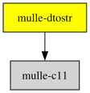

# mulle-dtostr

#### 🧶 Double to string conversion

A C implementation of the Schubfach algorithm - fast and accurate conversion
of IEEE-754 `double` values to decimal strings. Basically a fork of
[vitaut/zmij](https://github.com/vitaut/zmij), ported to C then
recoded for the needs of [mulle-sprintf](//github.com/mulle-core/mulle-sprintf)


* It should be faster than anything else
* It tests for dtostr <-> strtod roundtrip value compatibility


| Release Version                                       | Release Notes  | AI Documentation
|-------------------------------------------------------|----------------|---------------
|      [](//github.com/mulle-core/mulle-dtostr/actions) | [RELEASENOTES](RELEASENOTES.md) | [DeepWiki for mulle-dtostr](https://deepwiki.com/mulle-core/mulle-dtostr)


## Documentation & Guides

* [API Summary](asset/dox/api/toc)


## Usage

```c
#include <mulle-dtostr/mulle-dtostr.h>
#include <stdio.h>

int main(void) 
{
   char   buf[ MULLE__DTOSTR_BUFFER_SIZE];

   mulle_dtostr(6.62607015e-34, buf);
   puts( buf);
   return( 0);
}
```

### You are here




## Add

mulle-dtostr is a component of the [mulle-core](//github.com/mulle-core/mulle-core) library. So in your code include the mulle-core umbrella header:

``` c
#include <mulle-core/mulle-core.h>
```

### Add mulle-core to a cmake project

Add mulle-core to your `CMakeLists.txt` with
[FetchContent](https://cmake.org/cmake/help/latest/module/FetchContent.html):

``` cmake
include( FetchContent)

set( MULLE__CORE_TAG "master" CACHE STRING "branch or tag to fetch mulle-core from")

FetchContent_Declare( MULLE__CORE
   GIT_REPOSITORY https://github.com/mulle-core/mulle-core.git
   GIT_TAG        "${MULLE__CORE_TAG}")
FetchContent_MakeAvailable( MULLE__CORE)

target_link_libraries( ${PROJECT_NAME} PRIVATE mulle-core)
```


### Add mulle-core to a mulle-sde project

``` sh
mulle-sde add github:mulle-core/mulle-core
```

### Embed mulle-dtostr with clib

``` sh
clib install --out src mulle-core/mulle-dtostr
```

Append `src` to your include path (e.g. add `-isystem src`  to your `CFLAGS`)
and compile all the sources that were downloaded.

## Install

Use [mulle-sde](//github.com/mulle-sde) to build and install mulle-dtostr and all dependencies:

``` sh
mulle-sde install --prefix /usr/local \
   https://github.com/mulle-core/mulle-dtostr/archive/latest.tar.gz
```

### Manual Installation

Install the requirements:

| Requirements                                 | Description
|----------------------------------------------|-----------------------
| [mulle-c11](https://github.com/mulle-c/mulle-c11)             | 🔀 Cross-platform C compiler glue (and some cpp conveniences)

Download the latest [tar](https://github.com/mulle-core/mulle-dtostr/archive/refs/tags/latest.tar.gz) or [zip](https://github.com/mulle-core/mulle-dtostr/archive/refs/tags/latest.zip) archive and unpack it.

Install **mulle-dtostr** into `/usr/local` with [cmake](https://cmake.org):

``` sh
PREFIX_DIR="/usr/local"
cmake -B build                               \
      -DMULLE_SDK_PATH="${PREFIX_DIR}"       \
      -DCMAKE_INSTALL_PREFIX="${PREFIX_DIR}" \
      -DCMAKE_PREFIX_PATH="${PREFIX_DIR}"    \
      -DCMAKE_BUILD_TYPE=Release &&
cmake --build build --config Release &&
cmake --install build --config Release
```


## Author

[Nat!](https://mulle-kybernetik.com/weblog) for Mulle kybernetiK  


